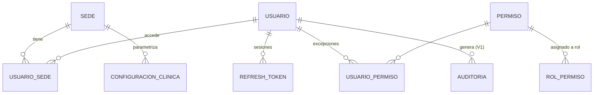
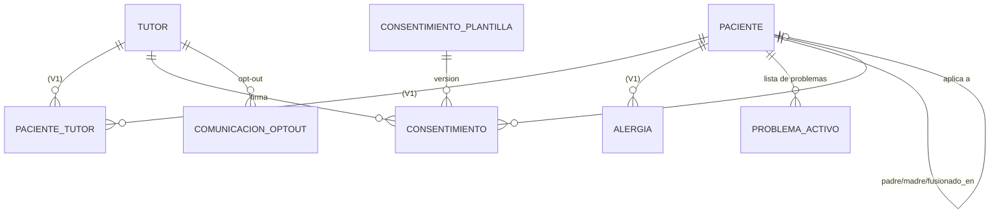
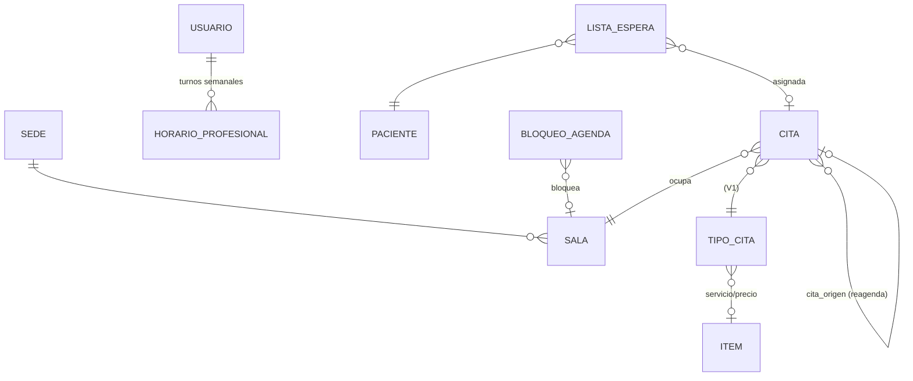
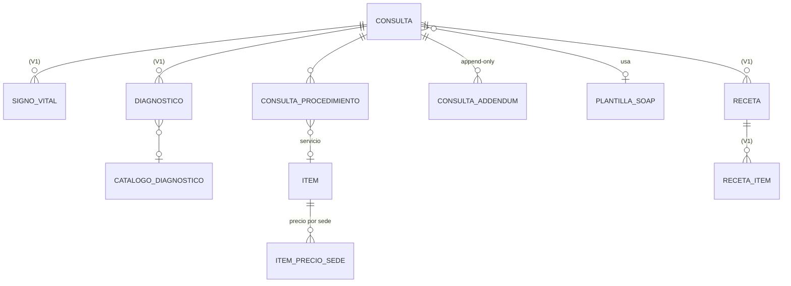
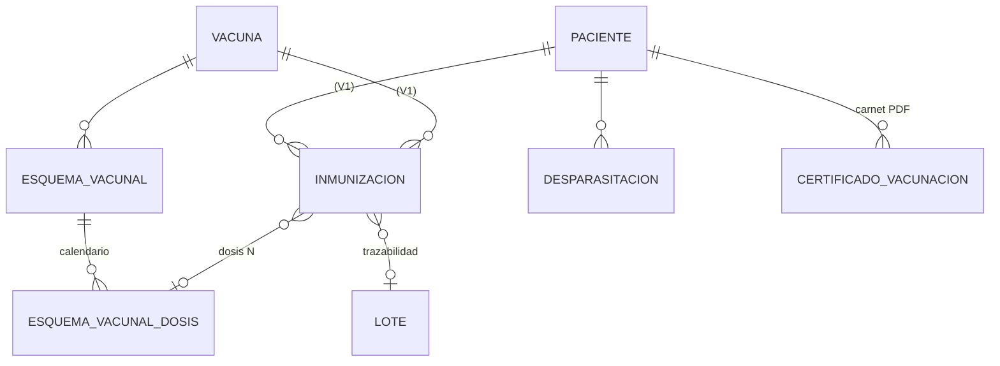
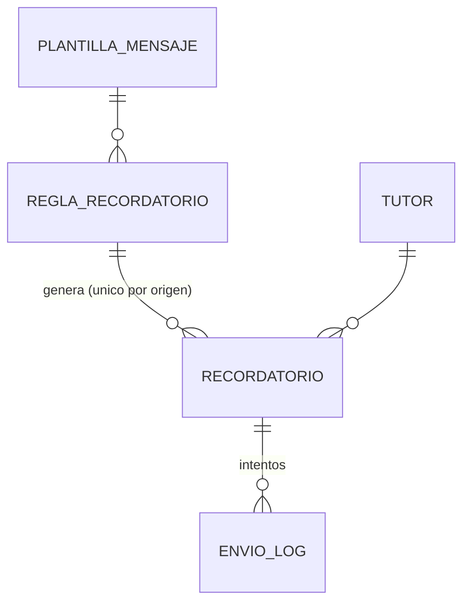
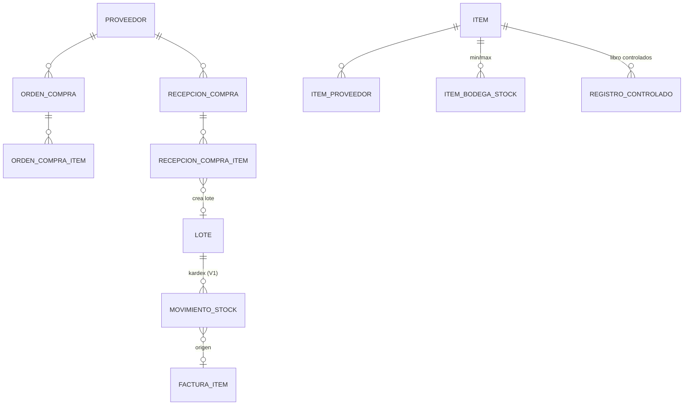
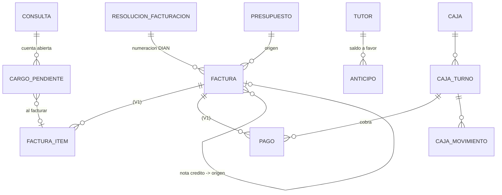
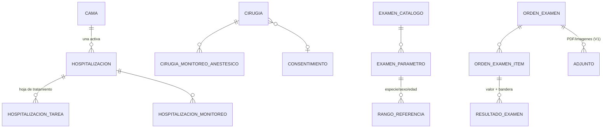
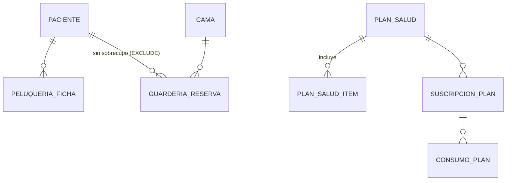

# Modelo de datos v2 - Sistema de gestion veterinaria (Colombia)

Fecha: 2026-10-13. Alcance: propuesta de migraciones V12-V22 (en `docs/migraciones-propuestas/`) sobre el esquema Flyway V1-V11 (34 tablas). Las propuestas **no** estan en `backend/src/main/resources/db/migration`: se copian alli cuando el equipo de backend las adopte. Validadas contra PostgreSQL 18 (V1-V11 + V12-V22 en orden, y re-aplicadas una segunda vez sin error: idempotentes). Resultado: 59 tablas nuevas, 93 en total.

## 1. Referencias consultadas y que se tomo de cada una

Limitacion honesta: no existe un PMS veterinario open source completo con su esquema publicado; los repos GitHub encontrados son proyectos pequenos (muchos de curso) y las referencias comerciales no publican modelo de datos. Se uso la lista de entidades/funciones que cada fuente declara, mas guias clinicas para los catalogos semilla. Lo que viene de conocimiento general (no verificado en una fuente) esta marcado en los comentarios SQL como "validar".

| # | Referencia | URL | Que se tomo |
|---|---|---|---|
| 1 | MukaddasA/VeterinaryClinicDatabase (MySQL; clientes, pacientes, doctores, casos, diagnosticos, recetas, inventario de farmacia, recibos) | https://github.com/MukaddasA/VeterinaryClinicDatabase | Confirma el nucleo minimo (cliente-paciente-caso-receta-inventario-recibo). Idea de ficha de farmacia con nombre comercial/generico, categoria y vencimiento -> `item` extendido (principio_activo, concentracion, via, marca). No se pudo leer `schema.sql`; solo la descripcion del README. |
| 2 | semih-turan/Veterinary-Management-System-API (Spring Boot + PostgreSQL, MIT) | https://github.com/semih-turan/Veterinary-Management-System-API | Mismo stack que el nuestro: doctores, clientes, animales, vacunas aplicadas y agenda con disponibilidad por doctor -> `horario_profesional` y tablas de agenda por profesional; vacuna con fechas de proteccion -> `periodo_eficacia_dias` y `fecha_proxima_dosis`. |
| 3 | geosem42/PetCare (Laravel + Vue; fork mielcarp/PetCare) | https://github.com/mielcarp/PetCare | Clientes, pacientes, calendario de citas e inventario de medicamentos y equipos -> confirma `item` como catalogo unico y vista calendario; stock por bodega. |
| 4 | Odoo `acs_hms_veterinary` / `hospital_veterinary_management_app` (modulos de apps.odoo.com) | https://apps.odoo.com/apps/modules/17.0/acs_hms_veterinary , https://apps.odoo.com/apps/modules/16.0/hospital_veterinary_management_app | Hospitalizacion con ingreso, traslado, alta y resumen de alta; maestro de camas/salas con estado ocupado/libre; pedidos de laboratorio con parametros y facturacion del diagnostico; farmacia ligada a compras y ventas -> `cama`, `hospitalizacion`, `orden_examen`, `examen_parametro`, `orden_compra`. Son modulos comerciales (OPL-1/pago): solo se uso la descripcion funcional, no codigo. |
| 5 | Odoo `vet_wellness_plans_reminders` y `vet_clinic_management` (LGPL-3, espanol) | https://apps.odoo.com/apps/modules/19.0/vet_wellness_plans_reminders , https://apps.odoo.com/apps/modules/18.0/vet_clinic_management | Planes de salud con recordatorios -> `plan_salud`, `suscripcion_plan`, `consumo_plan`, `regla_recordatorio`. |
| 6 | WSAVA Vaccination Guidelines 2024 | https://wsava.org/wp-content/uploads/2024/05/2024-Guidelines-for-the-Vaccination-of-Dogs-and-Cats.pdf (resumen PMC: https://pmc.ncbi.nlm.nih.gov/articles/PMC7166872) | Vacunas nucleo (perro: moquillo, adenovirus, parvovirus; gato: panleucopenia, calicivirus, herpesvirus-1; rabia nucleo donde es endemica), serie de cachorro/gatito cada 2-4 semanas con ultima dosis a las 16 semanas o mas, refuerzo a 6-12 meses, revacunacion nucleo no antes de cada 3 anios, FeLV nucleo en menores de 1 anio -> `vacuna.clasificacion`, `esquema_vacunal(_dosis)` y semilla. Rabia y leptospira anual se dejaron como practica local (validar normativa sanitaria colombiana). |
| 7 | AAHA (via Instinct, "10 common questions about veterinary medical recordkeeping standards") | https://instinct.vet/blog/10-common-questions-about-veterinary-medical-recordkeeping-standards/ | Registro cerrado dentro de maximo 24 h; enmiendas como addendum con trazabilidad; retencion segun ley (en EE. UU. hasta 7 anios). Origen de `consulta.cerrada_en`, `consulta_addendum` append-only y `clinica.horas_cierre_automatico`. Fuente secundaria: no se leyo el estandar AAHA directo. Retencion en Colombia: pendiente de asesor juridico. |
| 8 | VeNom Coding Group | https://en.wikipedia.org/wiki/VeNom_Coding_Group | Lista estandar de terminos para diagnostico al cierre de la visita, incluye tambien transacciones administrativas y preventivas -> columnas `codigo_venom` en `diagnostico` e `item` y `catalogo_diagnostico(sistema)`. Los codigos requieren permiso: se siembra catalogo propio `INTERNO`. |
| 9 | Benchmark ya documentado en `docs/plan-producto.md` (ezyVet, Provet Cloud, Shepherd, Digitail) | ver ese documento | Recordatorios omnicanal, cuenta abierta del paciente (cargos pendientes), cierre de caja, portal de tutor, multi-sede. |

## 2. Decisiones de arquitectura

1. **sede_id (V12).** Tabla `sede`, `usuario_sede` (sedes permitidas) y `configuracion_clinica` (clave/valor global o por sede). `sede_id` se agrega **nullable** a cita, consulta, factura, presupuesto, bodega, bloqueo_agenda, adjunto, inmunizacion (y `sede_origen_id` a paciente) y se rellena con la sede principal. Tutores, pacientes, catalogo de items y vacunas son **globales** (el paciente puede atenderse en cualquier sede); precios por sede en `item_precio_sede`. El aislamiento se aplica en la capa de servicio; RLS de Postgres queda como evolucion (requiere `SET LOCAL app.sede_id`).
2. **Auditoria.** `auditoria` se conserva y se extiende (`tipo_evento`: ESCRITURA/LECTURA/LOGIN/EXPORTACION, `sede_id`, `correlacion_id`). Ademas hay un trigger generico `fn_auditar_cambio()` (diff antes/despues en JSONB) en paciente, tutor, consulta, factura, pago y receta como red de seguridad. La app fija `SET LOCAL app.usuario_id` / `app.ip`; si el interceptor Java audita la misma operacion, fijar `app.auditoria_app = on` para no duplicar. Decidir un solo dueno por entidad. La lectura de historia (Ley 576/2000, secreto profesional) solo la puede registrar la app.
3. **Soft-delete.** Convencion: `activo` (ya existe) + `eliminado_en/eliminado_por` en tutor y paciente. Nunca DELETE fisico de tutor, paciente, consulta, factura. Tablas de catalogo se desactivan con `activo`.
4. **Inmutabilidad de consulta cerrada (V15).** Trigger `BEFORE UPDATE/DELETE` en `consulta`: si `OLD.estado='CERRADA'` se rechaza (P0001); DELETE siempre rechazado. Hijos (`signo_vital`, `diagnostico`, `consulta_medicamento`, `consulta_vacuna`, `consulta_procedimiento`) rechazan INSERT/UPDATE/DELETE si la consulta esta cerrada. Correcciones: `consulta_addendum`, append-only. Consecuencia para el backend: dentro de la transaccion de cierre, **escribir primero los hijos y por ultimo el UPDATE de estado**; no hay reapertura. `cerrada_en`, `cerrada_por` y `firma_hash` (SHA-256 del contenido canonico) los calcula la aplicacion. Regla analoga para facturas: una factura no `BORRADOR` no puede cambiar montos (se corrige con nota credito).
5. **Anti-solape de agenda.** Restriccion `EXCLUDE USING gist` por profesional y por sala sobre `tstzrange(inicio, fin)` para citas no canceladas/activas (reemplaza `uq_cita_vet_inicio`, que impedia reutilizar un horario cancelado). Se crea solo si no hay solapes previos (si los hay emite NOTICE). La app sigue devolviendo 409 al capturar la violacion.
6. **Convenciones.** Nombres en espanol snake_case; timestamps nuevos `TIMESTAMPTZ`; `CHECK` en lugar de enums de Postgres (consistente con V1); FK a `usuario` para profesionales (como cita/consulta en V1); catalogos con `activo`; semillas con `ON CONFLICT DO NOTHING`.
7. **Colombia.** Habeas data (Ley 1581/2012): `tutor.autoriza_tratamiento_datos`, `consentimiento` versionado con texto firmado y hash, `comunicacion_optout`. DIAN: `resolucion_facturacion`, CUFE, `estado_dian`, XML/PDF; la certificacion se delega a un proveedor tecnologico (no se guardan claves tecnicas en BD). Tutor "Consumidor final" (222222222222) para mostrador. IVA, retencion de historia y normativa de controlados quedan marcados "validar".

## 3. Hallazgos sobre el esquema actual (V1-V11)

- Falta V3 en la numeracion (hueco). Flyway lo tolera por defecto solo con `outOfOrder`/si nunca existio; no renumerar migraciones aplicadas.
- `consulta` real tiene columnas duplicadas por V4/V6/V7 (`fecha_hora` NOT NULL de V1 y `fecha`; `motivo_consulta` y `motivo`; `diagnostico_principal` y `diagnostico`). V1 no tiene `UNIQUE(codigo)` en consulta (V4 lo creaba, pero la tabla ya existia). Se sugiere una migracion de limpieza coordinada con el backend.
- `cita.estado` (CHECK V1: AGENDADA...) convive con `cita.estado_cita_id` (V9: PROGRAMADA...). Hay dos vocabularios distintos; unificar en una sola fuente.
- `cita` y `consulta` usan `creado_el/actualizado_el` (V4) y el resto `creado_en/actualizado_en`.
- `V8` es un no-op. `paciente` ya traia microchip, esterilizado, fallecido y color (V1): V13 solo agrega detalle.

## 4. ERD por modulo (Mermaid)

Las tablas marcadas con (V1) ya existen; las demas son nuevas.

### 4.1 Sedes, seguridad y configuracion (V12, V22)

### 4.2 Pacientes, tutores y consentimientos (V13)

### 4.3 Agenda (V14)

### 4.4 Clinica (V15)

### 4.5 Inmunizacion (V16)

### 4.6 Comunicaciones (V17)

### 4.7 Inventario y compras (V18)

### 4.8 Facturacion y caja (V19)

### 4.9 Hospitalizacion, cirugia y laboratorio (V20)

### 4.10 Servicios complementarios (V21)

## 5. Mapa de migraciones propuestas

| Archivo | Tema | Tablas nuevas |
|---|---|---|
| V12__sede_y_configuracion | sede, usuario_sede, configuracion, sede_id, soft-delete, auditoria (trigger) | sede, usuario_sede, configuracion_clinica (3) |
| V13__paciente_tutor_consentimientos | microchip detalle, pedigri, fallecimiento, contacto/habeas data, consentimientos, problemas | consentimiento_plantilla, consentimiento, problema_activo (3) |
| V14__agenda_salas_lista_espera | salas, horarios, anti-solape, lista de espera, tipos de cita | sala, horario_profesional, lista_espera (3) |
| V15__clinica_cierre_plantillas_servicios | cierre inmutable, addendum, plantillas SOAP, procedimientos, servicios con precio, catalogo dx | consulta_addendum, plantilla_soap, catalogo_diagnostico, item_precio_sede, consulta_procedimiento (5) |
| V16__inmunizacion_esquemas_desparasitacion | esquemas WSAVA, lote en aplicacion, desparasitacion, carnet | esquema_vacunal, esquema_vacunal_dosis, desparasitacion, certificado_vacunacion (4) |
| V17__comunicaciones_recordatorios | plantillas, reglas, cola, log, opt-out | plantilla_mensaje, regla_recordatorio, recordatorio, envio_log, comunicacion_optout (5) |
| V18__inventario_compras_proveedores | proveedores, compras, minimos, controlados, kardex ampliado | proveedor, item_proveedor, item_bodega_stock, orden_compra, orden_compra_item, recepcion_compra, recepcion_compra_item, registro_controlado (8) |
| V19__facturacion_caja_dian | resolucion DIAN, nota credito, caja/turno, anticipos, cargos pendientes | resolucion_facturacion, caja, caja_turno, caja_movimiento, anticipo, cargo_pendiente (6) |
| V20__hospitalizacion_cirugia_laboratorio | camas, hospitalizacion, cirugia/anestesia, laboratorio con rangos | cama, hospitalizacion, hospitalizacion_tarea, hospitalizacion_monitoreo, cirugia, cirugia_monitoreo_anestesico, examen_catalogo, examen_parametro, rango_referencia, orden_examen, orden_examen_item, resultado_examen (12) |
| V21__servicios_complementarios | peluqueria, guarderia/hotel, planes de salud | peluqueria_ficha, guarderia_reserva, plan_salud, plan_salud_item, suscripcion_plan, consumo_plan (6) |
| V22__permisos_finos_seguridad | permisos, roles ampliados, refresh token, 2FA/bloqueo | permiso, rol_permiso, usuario_permiso, refresh_token (4) |

Total: 59 tablas nuevas (las cuentas de la tabla suman 59). Semillas: 10 vacunas WSAVA/locales, 7 esquemas con 22 dosis, 12 tipos de cita, ~50 items (servicios, examenes, medicamentos), 4 plantillas SOAP, 25 diagnosticos, 2 examenes con 12 parametros y 24 rangos (perro/gato), 28 permisos, plantillas y reglas de recordatorio, 7 textos de consentimiento (ejemplo, validar con asesor juridico).

## 6. Pendientes y riesgos

- Los textos de consentimiento, rangos de referencia, precios COP, IVA, retencion y esquemas de rabia/leptospira son **ejemplos**; deben validarlos el veterinario responsable, el contador y el asesor juridico.
- El trigger de inmutabilidad cambia el orden de escritura del backend (hijos antes del cierre). Coordinar con quien reescribe el modulo `clinica`.
- `uq_bodega_nombre` (V1) es global: para multi-sede real habra que relajarlo a `(sede_id, nombre)`.
- Cuando se adopten, renombrar a la numeracion Flyway real si V12 ya esta ocupada, y ejecutarlas con Flyway (el usuario de BD debe poder crear las extensiones `pg_trgm` y `btree_gist`; son extensiones "trusted" desde PG13).
- No incluido (futuro): portal del tutor (autenticacion separada), telemedicina, integracion DIAN real, DICOM, RLS por sede.
